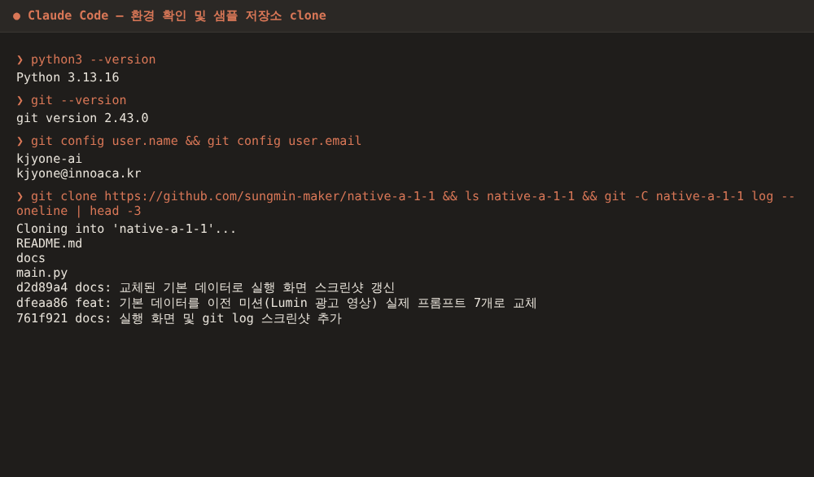
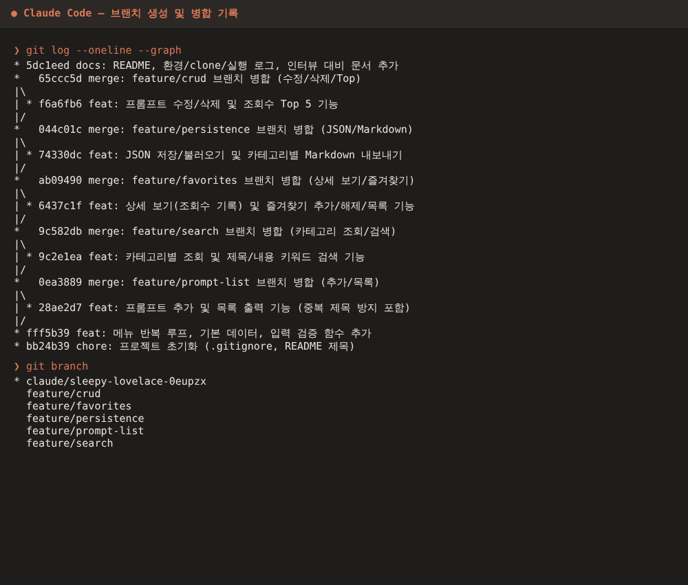

# 나만의 프롬프트 관리 프로그램

GenAI 작업 중 쌓이는 프롬프트(텍스트·이미지·영상 생성, 페르소나, 자동화 등)를
한 곳에서 **분류·검색·즐겨찾기**로 관리하는 Python 콘솔 프로그램입니다.

- 외부 라이브러리 없이 Python 기본 문법(리스트, 딕셔너리, 함수, 조건문, 반복문)과 표준 라이브러리(`json`, `os`)만 사용합니다.
- 데이터는 `prompts.json`에 자동 저장되어 프로그램을 종료해도 유지됩니다. (보너스 1)
- 프롬프트 수정/삭제, 조회수 기록, 조회수 Top 목록을 지원합니다. (보너스 2)

## 실행 방법

Python 3.10 이상, Git이 필요합니다.

```bash
git clone https://github.com/kjyone-ai/kimjiyeon2.git
cd kimjiyeon2

python3 --version      # 3.10 이상인지 확인 (Windows: python --version)
git --version

python3 main.py        # Windows: python main.py
```

실행하면 메뉴가 출력되고, 번호를 입력해 기능을 선택합니다. `0`을 입력하면 종료합니다.

## 기능 목록

| 번호 | 기능 | 설명 |
|---|---|---|
| 1 | 프롬프트 추가 | 제목·내용·카테고리 입력. 빈 값은 재입력, 제목이 중복이면 재입력, 카테고리는 목록 선택 또는 직접 입력 |
| 2 | 프롬프트 목록 | `번호. [카테고리] 제목 ⭐` 형식으로 전체 출력 |
| 3 | 카테고리별 조회 | 선택한 카테고리의 프롬프트만 출력 (직접 입력한 카테고리 포함) |
| 4 | 프롬프트 검색 | 키워드가 제목 **또는** 내용에 포함된 프롬프트 검색 (대소문자 무시) |
| 5 | 프롬프트 상세 보기 | 내용 전체 출력 + 조회수 1 증가 |
| 6 | 즐겨찾기 관리 | 번호 입력으로 추가/해제 (토글) |
| 7 | 즐겨찾기 목록 | 즐겨찾기한 프롬프트만 출력 |
| 8 | JSON 저장 | 현재 데이터를 `prompts.json`에 저장 (보너스 1) |
| 9 | JSON 불러오기 | `prompts.json`의 데이터로 목록 교체 (보너스 1) |
| 10 | Markdown 내보내기 | 카테고리별 `export/<카테고리>.md` 생성 (보너스 1) |
| 11 | 프롬프트 수정 | 제목/내용/카테고리 수정, Enter는 기존 값 유지 (보너스 2) |
| 12 | 프롬프트 삭제 | 확인(y/N) 후 삭제 (보너스 2) |
| 13 | 조회수 Top 5 | 조회수 높은 순 정렬 (보너스 2) |
| 0 | 종료 | 프로그램 종료 |

- 시작할 때 `prompts.json`이 있으면 불러오고, 없으면 기본 프롬프트 5개로 시작합니다. 파일이 깨졌으면 안내 후 기본 데이터를 사용합니다.
- 추가·상세 보기·즐겨찾기·수정·삭제 후에는 자동 저장됩니다.
- 잘못된 메뉴 번호, 숫자가 아닌 입력, 범위를 벗어난 번호에는 안내 메시지를 출력합니다.
- 조회·검색 결과의 번호는 **전체 목록 기준 번호**라서 상세 보기/즐겨찾기/수정/삭제에 그대로 입력할 수 있습니다.

## 데이터 구조

딕셔너리의 리스트입니다.

```python
prompts = [
    {
        "title": "회의록 요약",
        "content": "다음 회의 내용을 ... 요약해줘.",
        "category": "텍스트 생성",
        "favorite": True,
        "views": 2,
    },
]
```

## 코드 구조 (`main.py`)

| 구분 | 함수 | 역할 |
|---|---|---|
| 입력 검증 | `input_non_empty()`, `input_number()`, `input_unique_title()`, `select_prompt()` | 빈 값, 숫자/범위, 제목 중복 검증 |
| 메뉴 | `show_menu()`, `main()` | 메뉴 출력, `while True` 반복, 번호→함수 연결 |
| 추가/목록 | `add_prompt()`, `show_list()`, `choose_category()` | 등록, 전체 출력 |
| 조회/검색 | `show_by_category()`, `search_prompt()`, `find_prompts()` | 조건 함수로 필터링 |
| 상세/즐겨찾기 | `show_detail()`, `toggle_favorite()`, `show_favorites()` | 조회수, 토글 |
| 저장/내보내기 | `load_prompts()`, `save_prompts()`, `export_markdown()` | JSON, Markdown |
| 관리 | `edit_prompt()`, `delete_prompt()`, `show_top()` | 수정, 삭제, Top 목록 |

## 실행 화면 (Claude Code 터미널)

| 화면 | 파일 |
|---|---|
| Python/Git 버전, user.name/email, 샘플 저장소 clone | [01_env.png](docs/screenshots/01_env.png) |
| 메뉴 출력, 잘못된 입력, 프롬프트 추가, 목록 | [02_menu_add_list.png](docs/screenshots/02_menu_add_list.png) |
| 카테고리별 조회, 키워드 검색 | [03_category_search.png](docs/screenshots/03_category_search.png) |
| 즐겨찾기 추가/해제, 상세 보기 | [04_favorite_detail.png](docs/screenshots/04_favorite_detail.png) |
| 보너스: 조회수 Top, 수정, 삭제, JSON 저장, Markdown 내보내기 | [05_bonus.png](docs/screenshots/05_bonus.png) |
| 브랜치 생성/병합 기록 (`git log --graph`) | [06_git_graph.png](docs/screenshots/06_git_graph.png) |




## Git 작업 기록

기능 단위로 브랜치를 나눠 작업하고 `--no-ff`로 병합했습니다
(`feature/prompt-list`, `feature/search`, `feature/favorites`, `feature/persistence`, `feature/crud`).

- 환경 확인 로그: [docs/logs/01_env.txt](docs/logs/01_env.txt)
- 샘플 저장소 clone 기록: [docs/logs/02_clone.txt](docs/logs/02_clone.txt) (https://github.com/sungmin-maker/native-a-1-1)
- 전체 기능 실행 로그: [docs/logs/03_run.txt](docs/logs/03_run.txt)
- 브랜치/병합 그래프: [docs/logs/04_git_log.txt](docs/logs/04_git_log.txt)
- 인터뷰 대비 설명: [docs/INTERVIEW.md](docs/INTERVIEW.md)
